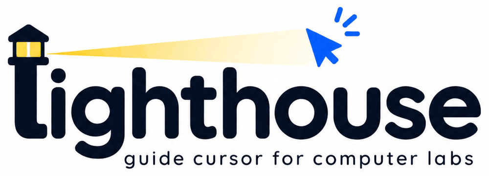

<h1 align="center">Find your next step.</h1>

A personal lab assistant that helps students learn computer tasks at their own pace. 🔦

<a href="https://github.com/LightHoouse/LightHouse-App/releases">Windows downloads</a> · <a href="https://github.com/LightHoouse/LightHouse-App">Desktop app</a> · <a href="https://github.com/LightHoouse/LightHosue-Backend">Backend</a> · <a href="https://github.com/LightHoouse/LightHouse-AI">AI service</a>

## Learning, one step at a time

Computer labs move quickly. Lighthouse is being built to help students find the next step without waiting for an assistant to reach their desk. Students keep control of their mouse and keyboard.

- **A guide beside your work.** Students join a group and press Alt+L for contextual chat beside their cursor.
- **Connected support.** Assistants record accessible controls across applications with a compact floating toolbar; the backend keeps recordings scoped to each group.
- **Grounded suggestions.** The AI service retrieves recorded steps and selects a reference; it does not invent selectors or coordinates.

## Repositories

| Repository | Purpose |
| --- | --- |
| [LightHouse-App](https://github.com/LightHoouse/LightHouse-App) | Electron cursor companion, native recorder, and Windows installer |
| [LightHosue-Backend](https://github.com/LightHoouse/LightHosue-Backend) | TypeScript API, MongoDB persistence, MQTT gateway, and Coolify deployment |
| [LightHouse-AI](https://github.com/LightHoouse/LightHouse-AI) | Python retrieval, step selection, guardrails, and evaluation |

## Where we are

Lighthouse is a Windows prototype. The backend and AI service are deployed. Two-client tests cover recording across native applications, Alt+L chat, live AI answers, and resolving controls in a relocated student window. Custom canvases and elevated applications are not covered; step completion verification and classroom progress views remain future work.

Version tags publish Windows releases only after source and packaged desktop tests pass, with checksums and a link to their test run. These are unsigned preview installers, not a completed classroom product.

## Team Utopia

Built by Calvin Wu, Williams Sandjaya, Vallerie Anne Jose, and Andrian Pratama for the *Smarter Campus and Learning* case.

## Contributing

Open an issue in the relevant repository with the steps to reproduce a problem or a concrete learning scenario. Keep student data, screenshots containing personal information, and credentials out of public reports.
